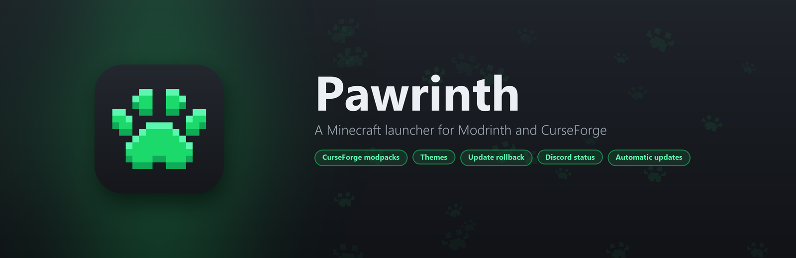
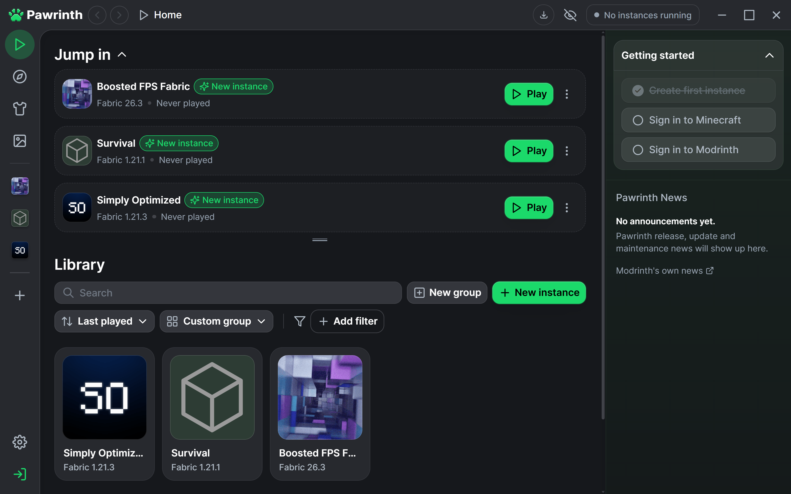
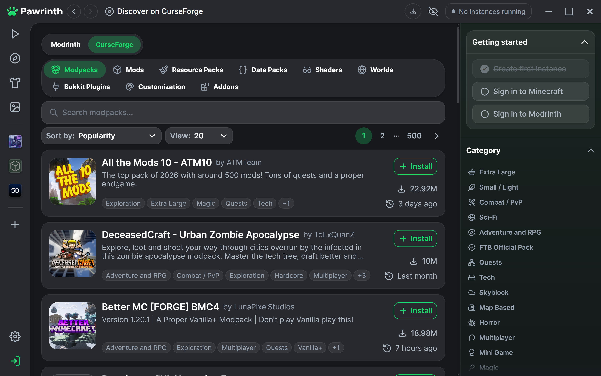
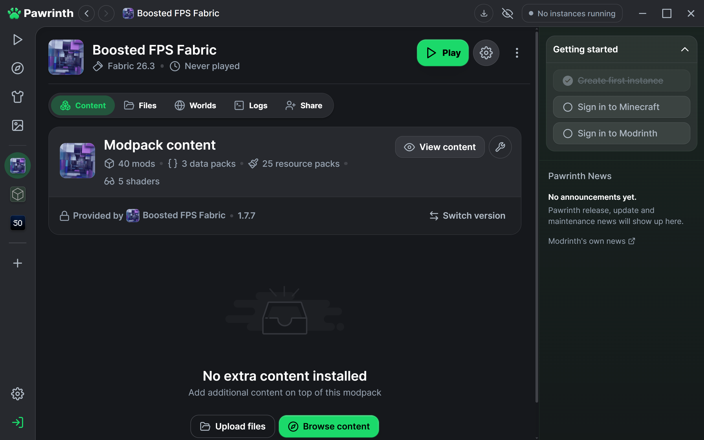
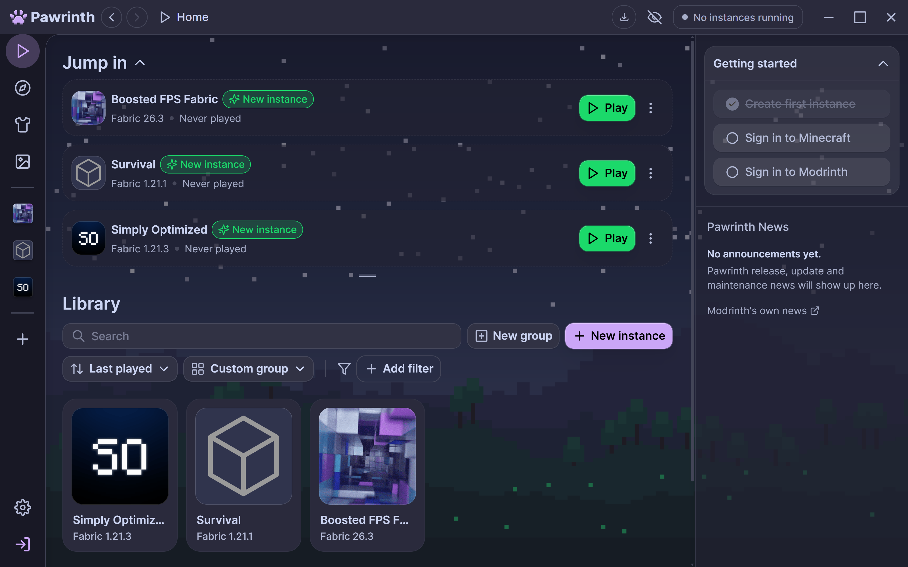
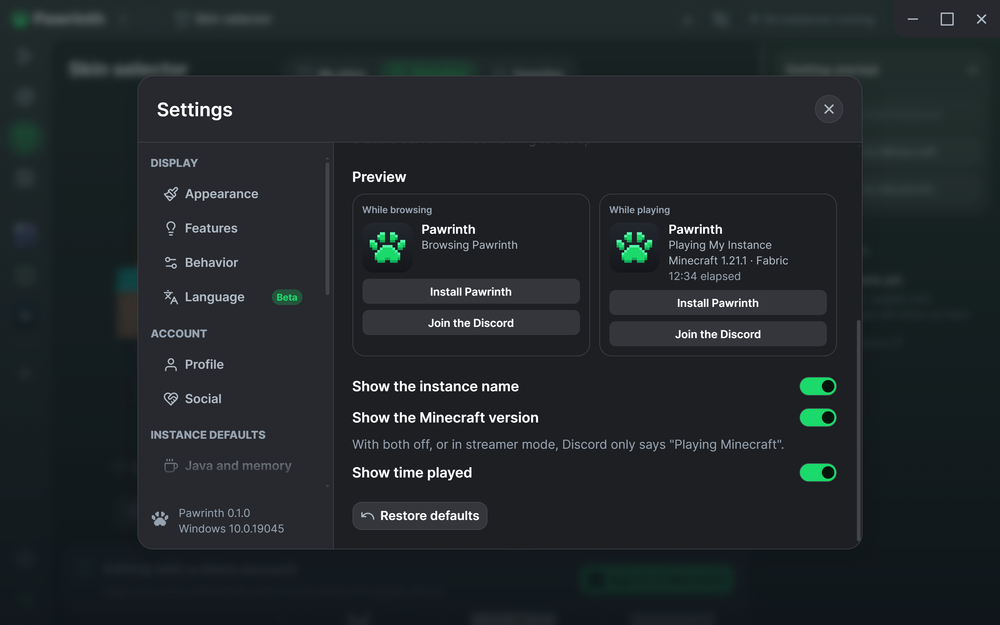
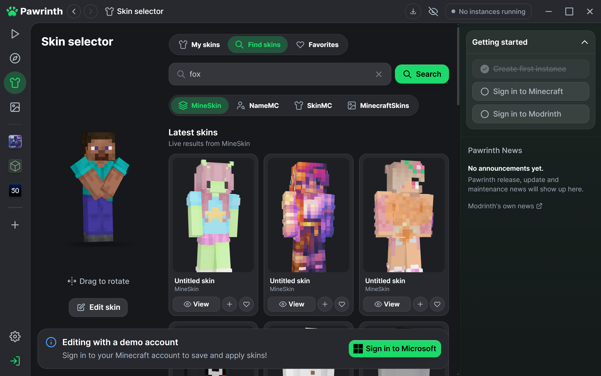

<p align="center">
	
</p>

<p align="center">
	<a href="https://github.com/pawmerized/Pawrinth/releases/latest"></a>
	<a href="https://github.com/pawmerized/Pawrinth/releases"></a>
	<a href="https://github.com/pawmerized/Pawrinth/actions/workflows/pawrinth-checks.yml"></a>
	<a href="#license"></a>
	<a href="https://discord.gg/HDVG4TmuB7"></a>
</p>

<p align="center">
	<a href="https://github.com/pawmerized/Pawrinth/releases/latest/download/Pawrinth-Setup.exe"><b>Download for Windows</b></a>
	&nbsp;·&nbsp;
	<a href="https://github.com/pawmerized/Pawrinth/releases">Release notes</a>
	&nbsp;·&nbsp;
	<a href="https://discord.gg/HDVG4TmuB7">Discord server</a>
	&nbsp;·&nbsp;
	<a href="https://github.com/pawmerized/Pawrinth/issues/new/choose">Report a problem</a>
</p>

Pawrinth is a Minecraft launcher for mods and modpacks from both Modrinth and CurseForge. Browse, install, update and play from one place, make it look the way you like, and undo an update that broke something. It keeps itself up to date, and it has no ads or tracking.

<p align="center">
	
</p>

## Features

### Modrinth and CurseForge in one launcher

- **Browse both** from the same Discover page, with the same filters, project pages, versions and creator pages.
- **One-click installs.** Inside an instance, Install picks the newest version that fits its Minecraft version and loader, and brings its required dependencies along.
- **CurseForge modpacks** install and update like Modrinth ones, with progress, pausing and retrying in the download manager. Files an author keeps off other apps are listed with links before anything is installed. Updates keep your worlds, your own config changes and the mods you turned off.
- **Export for CurseForge.** Share an instance as a CurseForge `.zip` as well as a Modrinth `.mrpack`, so friends on either app can play the same pack.

CurseForge needs a free API key from CurseForge, added once under Settings. Pawrinth only uses CurseForge's official API and keeps the key in Windows' credential store. [Why each person needs their own key](PAWRINTH.md#curseforge).

<p align="center">
	
	
</p>

### Make it yours

- **Themes:** Midnight, Nord, Dracula, Catppuccin, Gruvbox and more, or build your own in the theme editor with a live preview.
- **Accent color and UI scale** for the whole app.
- **Backgrounds:** your own picture or GIF behind the app, with blur, dimming and fit.
- **Theme files** to share a look with friends.

<p align="center">
	
</p>

### Updates you can undo

- **Update all, safely.** Every update is recorded, and the update history rolls an instance back to how it was, file for file.
- **Snapshots and compare:** save an instance's content before a big change, and compare two instances side by side.
- **Crash help:** common crash causes are pointed out in the logs.

### Discord status

Shows what you're playing on your Discord profile with nothing to set up, with buttons for friends to install Pawrinth or join its Discord server. Pick what's shown, write your own text and buttons, and see a live preview. Streamer mode reduces it to "Playing Minecraft".

<p align="center">
	
</p>

### And more

- **Skins:** a live skin gallery with search, 3D previews and favorites, and any player's current skin by username.
- **Streamer mode:** hides account names, avatars, friends and folder paths on screen and in logs.
- **Setup wizard** on first launch: choose a look and layout, and bring over instances from other launchers.
- **Pawrinth News** from this repository, right in the app.
- **Updates itself.** New releases download in the background and install when you restart, just like Modrinth App. Every update is checked against Pawrinth's signing key.
- **Next to Modrinth App:** its own folder, data and shortcuts, so both can be installed at once.
- **No ads, no analytics, no error reporting to third parties,** and no Modrinth Hosting.

Everything Modrinth App does is still here: instances, Microsoft sign-in, Modrinth accounts and friends, shared instances, worlds, screenshots, logs, and imports from Prism, MultiMC, ATLauncher, GDLauncher and CurseForge.

<p align="center">
	
</p>

## Install

1. Download **[Pawrinth-Setup.exe](https://github.com/pawmerized/Pawrinth/releases/latest/download/Pawrinth-Setup.exe)** from the latest release.
2. Run it. It installs for your Windows account only, so it doesn't ask for administrator permission.
3. Optional: add your CurseForge API key under **Settings, Pawrinth, API configuration**.

Windows may warn about the installer the first time, because it isn't signed with a code signing certificate yet. Choose **More info**, then **Run anyway**.

**Updating:** Pawrinth checks for new releases on its own, downloads them in the background and shows **Reload to update** in the title bar. Closing Pawrinth installs a downloaded update too. Your instances, worlds and settings are kept.

**Uninstalling** from Windows' Installed apps keeps your instances unless you tick the option to remove them.

Pawrinth is Windows only for now.

## Building from source

You'll need [Rust](https://rustup.rs), [Node.js](https://nodejs.org) (the version in `.nvmrc`) and [pnpm](https://pnpm.io).

```bash
pnpm install
cp packages/app-lib/.env.prod packages/app-lib/.env
pnpm app:dev
```

To build the installer, run `pnpm exec tauri build --config tauri-release.conf.json --bundles nsis` from `apps/app`, with `TAURI_SIGNING_PRIVATE_KEY` set. How releases, updates, the news feed, the Discord status and CurseForge work is in **[PAWRINTH.md](PAWRINTH.md)**.

## Community and support

- **Discord:** [discord.gg/HDVG4TmuB7](https://discord.gg/HDVG4TmuB7)
- **Problems and ideas:** [GitHub issues](https://github.com/pawmerized/Pawrinth/issues/new/choose)

Please report problems with Pawrinth here rather than to Modrinth, since they may come from Pawrinth's own changes.

## License

Pawrinth is built on the open-source code of [Modrinth App](https://github.com/modrinth/code) by the Modrinth team and contributors, and like it is free software under the [GNU General Public License, version 3](apps/app/LICENSE). Other folders keep their own licenses, listed in [COPYING.md](COPYING.md). What Pawrinth changed is described in [PAWRINTH.md](PAWRINTH.md).

Pawrinth isn't affiliated with or endorsed by Rinth, Inc., CurseForge or Overwolf, Mojang or Microsoft. Minecraft is a trademark of Mojang AB.
